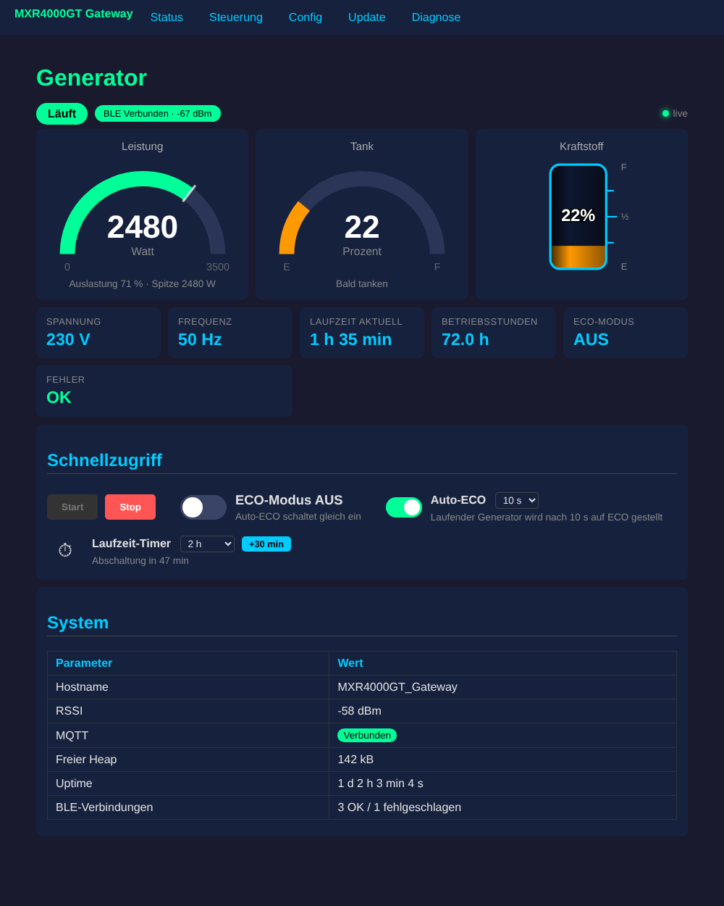

# MaXpeedingRods MXR4000GT → ESP32 → MQTT / Home Assistant

ESP32 firmware that connects to a **MaXpeedingRods MXR4000GT** inverter generator via **Bluetooth LE (Tuya BLE)** and makes it controllable via **MQTT / Home Assistant** and a local web dashboard – no cloud, no phone app needed. *(Documentation below in German.)*

---

ESP32-Firmware, die sich per **Bluetooth LE** mit dem Stromaggregat **MaXpeedingRods MXR4000GT** verbindet und es über **MQTT / Home Assistant** und ein Web-Dashboard steuerbar macht. Ohne Cloud und ohne Handy-App, ausgelegt für monatelangen Betrieb ohne Zugriff vor Ort.

## Funktionen

- **Live-Dashboard** im Browser: Gauges für Leistung und Tank, Kraftstoffanzeige, Spannung, Frequenz, Laufzeit, Fehler. Aktualisiert alle 2 s.
- **Steuerung:** Start/Stop, ECO-Modus
- **Auto-ECO:** Läuft der Generator, wird nach 5/10/15/20 s automatisch auf ECO geschaltet.
- **Laufzeit-Timer:** stoppt den Generator nach einer einstellbaren Höchstlaufzeit (Standard 2 h), mit „+30 min“-Verlängerung
- **Home Assistant:** MQTT-Discovery mit Sensoren, Schaltern, Auswahlfeldern und Buttons. Werte, die der Generator nicht meldet, werden automatisch entfernt.
- **Sicherheit:** Fernstart standardmäßig gesperrt (in der Config freischalten). Gespeicherte (retained) MQTT-Befehle werden ignoriert.
- **Dauerbetrieb:** Hardware-Watchdog, automatische Wiederverbindung für BLE, WLAN und MQTT, Neustart bei hängendem BLE-Stack oder knappem Speicher, zwei Fallback-WLANs, Access-Point-Modus
- **Diagnose-Seite:** alle empfangenen Datenpunkte roh plus Ereignisprotokoll (wer hat wann was geschaltet)
- **OTA-Update** über das Web-Interface

## Hardware

- ESP32 mit Bluetooth LE, getestet mit **AZDelivery ESP32 D1 Mini (ESP32-WROOM-32)**. ESP32-S3 und -C3 sollten ebenfalls funktionieren.
- 5-V-Netzteil mit mindestens 1 A. WLAN und BLE gleichzeitig erzeugen Stromspitzen.
- Abstand zum Generator so wählen, dass die BLE-Signalstärke besser als ca. −85 dBm ist.

## Kompilieren (Arduino IDE)

| Einstellung | Wert |
|---|---|
| ESP32-Core | 3.x (getestet 3.1.1) |
| Board | „ESP32 Dev Module“ oder „WEMOS D1 MINI ESP32“ |
| Partition Scheme | **Minimal SPIFFS (1.9MB APP with OTA)** |
| Bibliotheken | **PubSubClient** (Nick O'Leary), **NimBLE-Arduino** 2.x (h2zero) |

1. `Stromaggregat_Bluetooth/secrets.example.h` nach **`secrets.h`** kopieren und ausfüllen. `secrets.h` steht in `.gitignore`.
2. `Stromaggregat_Bluetooth/Stromaggregat_Bluetooth.ino` öffnen, kompilieren und flashen.

Die Felder in `secrets.h` können auch leer bleiben. Dann startet das Gateway den Access Point **`MXR4000`**. Unter `http://192.168.4.1` → **Config** trägst du WLAN, MQTT und die Generator-Daten ein.

## Generator-Zugangsdaten (local_key) besorgen

Die Kommunikation ist AES-verschlüsselt. Das Gateway braucht **local_key**, **uuid** und **Device-ID** des Generators aus der Tuya-Cloud:

1. Den Generator in der App **Smart Life** koppeln (vorher aus der MaXpeedingRods-App entfernen).
2. Auf [platform.tuya.com](https://platform.tuya.com) einen kostenlosen Account und ein Cloud-Projekt anlegen (Rechenzentrum passend zur Region, z. B. *Central Europe*).
3. Im Projekt unter **Devices → Link App Account** den QR-Code mit Smart Life scannen.
4. **Cloud → API Explorer → Device Management → „Query Device Details“** mit der Device-ID aufrufen. Die Antwort enthält `local_key`, `uuid` und `id`.
5. Die BLE-MAC findest du z. B. mit der App *nRF Connect*.

⚠️ Der `local_key` **ändert sich bei jedem Neu-Koppeln** des Generators mit einer App. Den neuen Key dann im Web-Interface unter Config eintragen.

Der Generator erlaubt **nur eine BLE-Verbindung** gleichzeitig. Zum Benutzen der Handy-App im Dashboard unter „Steuerung“ auf **BLE trennen** klicken. Nach 30 min verbindet sich das Gateway automatisch wieder.

## MQTT

Topic-Präfix: Standard `MXR4000GT`, einstellbar.

| Topic | Inhalt |
|---|---|
| `MXR4000GT/status` | `online` / `offline` (LWT) |
| `MXR4000GT/ble/status` | Generator erreichbar: `online` / `offline` |
| `MXR4000GT/<wert>/state` | z. B. `leistung`, `spannung`, `frequenz`, `tank`, `laufzeit`, `status`, `fehler` … |
| `MXR4000GT/generator/set` | `ON` / `OFF` (Start nur mit Fernstart-Freigabe) |
| `MXR4000GT/eco/set` | `ON` / `OFF` |
| `MXR4000GT/auto_eco/set` | `ON` / `OFF` |
| `MXR4000GT/auto_eco_delay/set` | `5 s` / `10 s` / `15 s` / `20 s` |
| `MXR4000GT/laufzeit_timer/set` | `Aus`, `30 min`, `1 h`, `1,5 h`, `2 h`, `3 h`, `4 h`, `6 h`, `8 h` |
| `MXR4000GT/timer_plus/set` | Minuten, um die der aktuelle Lauf verlängert wird (z. B. `30`) |
| `MXR4000GT/ble_aktiv/set` | `ON` / `OFF` |

Home Assistant findet alle Entitäten automatisch über MQTT-Discovery.

## Web-Interface

| Seite | Inhalt |
|---|---|
| `/` | Live-Dashboard, Schnellzugriff, Systeminfo |
| `/ctrl` | Steuerung (Start/Stop, ECO, BLE trennen) |
| `/config` | WLAN, MQTT, Generator-Zugangsdaten, Fernstart, Auto-ECO, Laufzeit-Timer |
| `/update` | OTA-Firmware-Update (.bin) |
| `/dp` | Diagnose: Datenpunkte roh + Ereignisprotokoll |
| `/api` | alle Werte als JSON |

## Protokoll

Beschreibung von Tuya-BLE-Framing, Verschlüsselung und Datenpunkten: [docs/protocol.md](docs/protocol.md)

## Sicherheitshinweise

- Ein Generator erzeugt **Kohlenmonoxid**. Fernstart nur, wenn er sicher im Freien steht. Der Fernstart ist deshalb standardmäßig gesperrt.
- Das Web-Interface hat **keinen Passwortschutz**. Betreibe das Gateway nur in einem vertrauenswürdigen Netz und mach es nicht aus dem Internet erreichbar.
- Inoffizielles Projekt, keine Verbindung zu MaXpeedingRods oder Tuya. Nutzung auf eigene Gefahr.

## Lizenz

[MIT](LICENSE)
